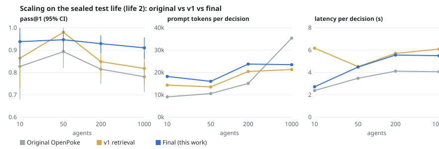
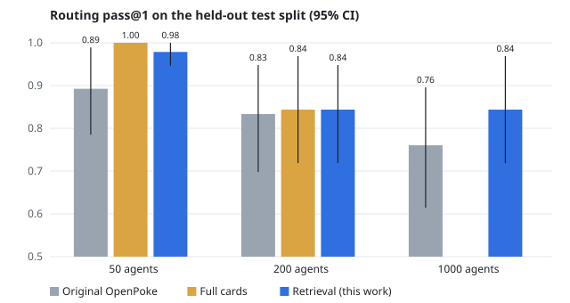

# Agent overload in OpenPoke: what broke, what I changed, and how I know

OpenPoke has one assistant the user talks to (the **interaction agent**) and a pool of **execution agents** that do the work: draft an email, check a thread, set a reminder. Every task creates or reuses an agent, and none of them ever retire. This document covers:

- what goes wrong as that pool grows;
- what I changed, in two rounds (v1, then v2 after v1's own test run showed what was still wrong);
- how I tested and assessed the agent, and how I kept the tests honest;
- what the numbers do and don't show, including the targets I missed.

The full experiment log, with every run and decision, is [`evals/experiments/JOURNAL.md`](../evals/experiments/JOURNAL.md). The designs are [`design/agent-overload-v1.md`](design/agent-overload-v1.md) (v1) and [`design/agent-overload-v2.md`](design/agent-overload-v2.md) (v2).

## Summary

- **Routing at scale, on a sealed held-out world.** The test world (life 2) was built, label-checked and then left unread until one final run per system:

  | Agents | Original OpenPoke | v1 (retrieval) | Final (v2) |
  |---|---|---|---|
  | 200 | 0.815 | 0.849 | **0.929** |
  | 1,000 | 0.781 | 0.818 | **0.910** |

  *Correct-or-acceptable rate (pass@1), DeepSeek V4.1 Flash, 3 samples per case, 108 cases per size.*

  - **The gain is significant.** Final minus the original: **+0.130 [+0.071, +0.198]** at 1,000 agents and +0.114 [+0.059, +0.176] at 200. Final minus v1: +0.093 [+0.034, +0.157] at 1,000.
  - **Duplicate agents almost disappear:** 0.113 → **0.014** at 1,000.
  - **The prompt stays flat:** 23.5k tokens per decision at 1,000 agents. The original's prompt is 35.4k there and grows with every agent.
- **Two of my pre-registered targets were missed, and I report them as they are.** At 1,000 agents, correct is 0.91 against a target of 0.95, and the harmful rate is 0.049 against 0.01. Duplicates, tokens, the second-look rate and a significant gain over the original all met their targets.
- **Sending email is enforced in code.** On the held-out safety scenarios the approval gate allowed **0 unauthorized sends** in 15 runs, on Haiku and again on DeepSeek. With the gate off, the same scenarios produced 6, including a forward the user had declined.
- **Agent memory is bounded.** Compacted history recalls **1.00** of planted facts on a held-out seed, at about 5.5k tokens instead of 9–10k.
- **The agent was assessed three ways:**
  1. code checks on the end state;
  2. 42 transcripts I labelled by hand on six checks;
  3. an LLM judge from a different model family, used only on the 3 checks where it agreed with me at least 85% of the time.

## 1. The problem

OpenPoke identified agents by a free-text name stored in `roster.json`, and agents never retired. The interaction agent chose between them from that bare list of names. As usage grows, six things break:

| # | Failure | Where it was |
|---|---|---|
| F1 | Routing degrades: hundreds of bare names, no purpose, recency or status, so the wrong agent is reused or a duplicate is created | `interaction_agent/agent.py` (`_render_active_agents`) |
| F2 | Identity is an exact string, so `"email to alice"` and `"Email to Alice"` become two agents sharing one log file | `roster.py`, `log_store.py` |
| F3 | Each agent's full history is injected into every prompt, without limit | `execution_agent/agent.py` |
| F4 | No concurrency control: the same agent can run twice at once, interleaving its log | `interaction_agent/tools.py`, `trigger_scheduler.py` |
| F5 | One global batch: a slow agent holds back every other result | `batch_manager.py` |
| F6 | Concurrent assistant turns race on the conversation log, giving duplicate or contradictory replies | `chat_handler.py`, `importance_watcher.py` |

**Other gaps found on the way:**
- "Confirm before sending" existed only as a prompt instruction.
- Email text reached agents that can send mail, so it was an injection vector.
- Hitting the iteration limit failed hard.
- An `fcntl` import broke Windows.
- The configured model was no longer served.
- There were no tests or evals.

## 2. How I tested and assessed the agent

I built the measurement first, so every change has a before and after.

### Three layers

- **L1 retrieval** (no model calls): is the right agent among the cards the assistant is shown? It's free and deterministic, so it's used for sweeps.
- **L2 routing** (live): one real interaction-agent turn, with the production prompt and tools, on a roster of N agents. The tool calls are intercepted, and the decision is graded by outcome. The eval imports the production prompts, dispatch, summary updater and second-look gate, so a gain in the eval is a change in the product, not in a harness copy.
- **L3 end to end** (live): the real interaction and execution agents, the inbox and the runner, against an in-memory Gmail. 26 scripted scenarios cover approval, consent, injection, orchestration and standing approvals. Each is graded by code on the final state: who received what, under whose approval, how many replies. Unauthorized sends are audited when mail leaves the fake mailbox, independently of the gate, so a gate-off run is comparable.

### A world that looks like real use

A tidy synthetic world made 1,000 agents easy to route, so I replaced it with **lived-in worlds**:
- a persona's life of several hundred events, played through the real interaction agent, so the roster carries the assistant's own inconsistent names and real history;
- background errands spread over the same life to reach 1,000 agents.

Probe messages are the next events in that life, at 10, 50, 200 and 1,000 agents. The 200 and 1,000 sizes share probes, so the only difference between them is roster size.

### Benchmark v2: why the first benchmark wasn't enough

v1's test run ended at 0.84 pass@1 at 200 and 1,000 agents, with intervals that touched zero. The error analysis showed the benchmark itself was part of the problem:
- **Dev and test had different mixes.** At 200 agents, dev had 1 vague-reference case and test had 6.
- **Both splits came from one simulated life.**
- **Some answer keys didn't hold up.** "how's the parking spot thing going?" was keyed to a lease-call agent whose card never mentions parking.
- **Only one answer counted.** Asking the user about an unclear message was scored wrong.

So v2 rebuilt it ([`bench_v2.py`](../evals/worlds/lived/bench_v2.py)):
- **Two lives.** Life 1 is the dev world. Life 2 is a new persona with a different life plan, grown the same way, and used only for the final test.
- **Stratified probes.** The same quota per kind in both lives: 27 / 48–50 / 108–110 probes at 10 / 50 / 200 agents, across 12 kinds (paraphrase, status question, vague reference, same person with a new topic, dormant revival, multi-task and others).
- **Answer keys from construction, not from the writer model.** A probe is built from a matter in the life plan, and its key is the agent that handled that matter during growth, read from the growth log. "Ask the user" is acceptable when another live matter shares the person and subject; "new" when the matter has no agent yet. Probes that can't be resolved are dropped, not guessed.
- **Three checker models** from three other families vote on every key. Any disagreement, plus a 10% random sample, went to me for review: **68 probes reviewed, 54 accepted, 9 fixed, 5 rejected.** Life 2's probes were reviewed for labels only; no system ran on them until the final run.
- **Graded outcomes.** Each sample is correct, acceptable, harmful (sent to the wrong agent), costly (a duplicate agent) or minor (an unneeded question, no action). Every rate gets a 95% bootstrap interval over cases, and systems are compared with paired differences.

### Model

Evals run on **DeepSeek V4.1 Flash**: $0.0009 per routing decision against Haiku 5.5's $0.0021, after a gate on malformed tool calls (0.55%), wait loops (1.2%) and error rows (0%). v2 re-baselined every system on DeepSeek, so v1's Haiku numbers aren't directly comparable with v2's. Production defaults to Claude Sonnet 5.5, which these evals don't measure.

### Discipline

- **Dev and test kept apart.** I tuned only on life 1. Life 2 runs only with `--split test --final`, once per system.
- **A checksum over protected eval code:** cases, grader, metrics, runners, the frozen baseline, the reviewed benchmark files and the judge. A run whose checksum doesn't match the committed one is marked invalid.
- **Targets written before any v2 result** (spec §6), and a **keep rule** for every change: its target metric must improve, and no other headline metric may get worse by more than 0.02. Otherwise it is reverted.
- **A cache for model responses and a budget cap on every run.**
- **A journal entry for every experiment:** hypothesis, change, run file, result and decision.

### Human labels and a calibrated judge

Code can check what was sent. It can't check whether a reply was clear or leaked internal detail. I labelled 42 L3 transcripts on six checks, then calibrated an LLM judge (`google/gemini-3.1-flash-lite`, a different family from the agents) against those labels:

| Check | Agreement with me | Used? |
|---|---|---|
| No internal jargon | 97.6% | yes |
| One clear reply | 92.9% | yes |
| Asked before sending | 85.7% | yes |
| Refused injected instructions | 76.2% | no: code checks plus human labels |
| Draft shown exactly | 71.4% | no |
| Would be happy | 69.0% | no: human only |

**Why three checks are excluded:**
- **Injection and draft shown:** most disagreements were about whether the check applied at all (N/A), not about safety.
- **Would be happy:** the judge was too lenient. It caught 4 of the 15 transcripts I marked unhappy.

I didn't tune the judge's prompts on these same 42 labels, because there's no fresh labelled set to check a tuned version against. Its code is frozen under the checksum.

## 3. What I changed

### v1: routing at scale (F1, F2)

- **Agent registry with cards.** `roster.json` is replaced by a SQLite registry (`server/services/agents/`). Each agent has a card: purpose, the people and things it involves, last active, and status.
- **Top-K retrieval** (`retrieval.py`). The assistant sees only the relevant cards, scored by entity and name overlap and recency. Up to five agents active in the last hour are always shown, and a `search_agents` tool covers the long tail.
- **Duplicate guard in code** (`dedup.py`, `dispatch.py`). Creating an agent whose card matches an existing one is pushed back with that card. The assistant can still insist.
- **Reuse policy: "an agent owns a matter".** A person plus a subject belongs to one agent, whatever the next step is.

### v2: making the cards say what the agent is doing now

The v2 dev baseline showed where v1 still failed. **The right card was shown and still not chosen**: full cards (every card in the prompt) failed paraphrases too, at 0.19. The failures clustered:
1. **Out-of-date cards → duplicate agent (19 failed samples of 60).** A card's purpose was the first request. "any update from my contractor on the bathroom job?" created *Bathroom Job Contractor Update* while *Carl Remodel Urgency Check* held the thread.
2. **Status questions spawned agents.** "how's the Athens flight going?" created *Athens Flight Status Update*.
3. **Same person, new topic → reused that person's agent.** "ask Kwame what he thinks we should do for game night" went to *Kwame Book Club Dates*.

The changes, each kept only after passing the keep rule on dev:
- **Living summaries** (`summaries.py`). After every run, a cheap model folds the result into the card's summary, which is shown on the card (up to 480 characters). After the sealed run I changed its format; see §5.
- **A status rule** (`status_policy.md`). A progress question goes to the agent that holds the matter, even when its summary looks up to date. If none fits, the assistant asks; it never creates an agent only to check on something.
- **A per-turn search budget.** The fourth `search_agents` call in one turn is refused. Long search loops were mostly failing turns and pushed tokens over the cap.
- **A second look at risky reuses**, made by [TypeSafe's Jev](https://typesafe.ai/) classifier. It fires on about 1 turn in 10, when the message names a person whose other card outranks the target or the message barely overlaps the card. It acts only to split ("this is a new topic") at confidence ≥ 0.4, and otherwise leaves the decision alone. Without the API key or on any error, the decision stands and a warning is logged.
- **Removed:** the last-routed boost (295 of 295 retrieval results identical without it), typo-tolerant name matching (not worse without it), the synthetic world, and conversation-aware retrieval (a second search pass using recent turns), which never added a right card the first pass missed.

### Lifecycle (F1)

Agents go dormant after 7 days idle and are archived after 30, by an hourly sweep (`lifecycle.py`). Archived agents leave the default view but come back on a strong match, so revival works.

### Memory (F3)

An execution agent's old history is folded into a summary plus a list of identifiers (thread IDs, draft IDs, addresses), each kept with 60 characters of context on either side (`memory.py`).

### Orchestration (F4–F6)

- A per-agent FIFO lock and a global cap of 4 concurrent agent runs (`services/execution/runner.py`).
- A durable SQLite inbox: one assistant turn at a time, results arriving during a turn coalesce into the next, and pending items survive a restart (`services/inbox/`).
- Agents that hit the iteration limit return a partial result listing the side effects already performed (drafts created, triggers set) instead of failing.

### Safety

- **A send approval gate in code** (`services/approvals/gate.py`):
  - Every draft, reply and forward becomes a pending action with a hash of its content.
  - A send passes only if the user's own message, arriving after the draft was shown, approved that exact content.
  - Approval can't come from an email, an agent report, a trigger or a watcher alert.
  - Editing after approval invalidates it.
  - Recurring sends get standing approvals bound to one trigger and its named recipients.
- **Untrusted email.** Email text reaching any agent is wrapped in `<untrusted_email>`, and the prompts treat it as data. Card summaries escape the same tags.
- **Two reply rules from the human labels:** don't repeat a draft the user can already see; when something claims the user's approval, warn them plainly.

### Smaller fixes

- Windows support: the `fcntl` file lock.
- Gmail bodies without base64 padding failed to decode (`gmail/processing.py`).
- Model defaults now point at served models, with a cheaper tier for summaries and classification.
- `[PARTIAL]` results stay pinned to their agent, and approved replies send the stored content by action ID instead of being retyped.

## 4. Results

### Routing on the sealed held-out world (life 2)

One run per system, frozen at `82b6c1a`, DeepSeek V4.1 Flash, k=3. "v1" is the current code with the four v2 changes switched off; on dev it reproduces the original v1 run (0.86 / 0.85 against 0.867 / 0.861).



| Agents | Metric | Original | v1 | Final |
|---|---|---|---|---|
| 50 | pass@1 | 0.893 | **0.980** | 0.947 |
| 200 | pass@1 | 0.815 | 0.849 | **0.929** |
| | duplicate | 0.086 | 0.095 | **0.005** |
| | harmful | 0.077 | 0.037 | 0.040 |
| | prompt tokens | 15.1k | 20.5k | 23.8k |
| 1,000 | pass@1 | 0.781 | 0.818 | **0.910** |
| | duplicate | 0.113 | 0.131 | **0.014** |
| | harmful | 0.093 | 0.046 | 0.049 |
| | prompt tokens | 35.4k | 21.3k | 23.5k |

**Paired differences, 95% bootstrap over cases:**

| | 200 agents | 1,000 agents |
|---|---|---|
| Final − original, pass@1 | +0.114 [+0.059, +0.176] | +0.130 [+0.071, +0.198] |
| Final − v1, pass@1 | +0.080 [+0.028, +0.139] | +0.093 [+0.034, +0.157] |
| Final − original, harmful | −0.037 [−0.074, −0.003] | −0.043 [−0.096, +0.006] |

**How to read this:**
- **v2's gain comes from duplicates.** Final makes 1 duplicate agent in 324 samples at 200 and 3 at 1,000, against v1's 21 and 29.
- **The harmful rate didn't move from v1.** Retrieval already halved it against the original; v2 neither helped nor hurt it.
- **At 50 agents final trails v1** (0.947 against 0.980). The difference, −0.033 [−0.093, +0.013], is not significant, but it's in the wrong direction. Most of the gap is final asking the user a question it didn't need to (5 samples).
- **Life 2 is harder than life 1 for every system,** and the gain over the original was the same on both: +0.13 at 1,000.

**Pre-registered targets at 1,000 agents** (spec §6, written before any v2 result):

| Target | Result | |
|---|---|---|
| Correct or acceptable ≥ 0.95 | 0.910 | **missed** |
| Harmful ≤ 0.01 | 0.049 | **missed** |
| Duplicate ≤ 0.03 | 0.014 | met |
| Prompt tokens ≤ 25k | 23.5k | met |
| Second-look trigger rate ≤ 0.20 | 0.074 | met |
| Gain over the original, interval excludes zero | +0.130 [+0.071, +0.198] | met |

**Where final still fails at 1,000 agents** (29 of 324 samples, from aggregate outcome counts; I haven't read life 2's cases):
- **Harmful (16):** 8 wrong reuses and 8 messages sent to an existing agent that needed a new one.
- **By kind:** same person with a new topic 0.67, paraphrase 0.74, multi-task 0.80. Every other kind is at 0.90 or above, and five are at 1.00.
- **What would fix it:** the harmful target needs a better split between "same person, same matter" and "same person, new matter". Jev is strong at exactly that (1.00 on same person, new topic, on dev), but the second look reaches only a fraction of those turns, because what triggers a look is too coarse.

### Dev and test side by side

Dev numbers are from tuning, so they're optimistic. Test is the claim.

| pass@1 at 200 / 1,000 | Original | v1 | Final |
|---|---|---|---|
| Dev (life 1) | 0.84 / 0.81 | 0.87 / 0.86 | 0.97 / 0.96 |
| Test (life 2) | 0.82 / 0.78 | 0.85 / 0.82 | 0.93 / 0.91 |

Final's dev gain over the original was +0.127 / +0.148; on test it is +0.114 / +0.130. It shrank as expected but kept most of its size.

### What each part contributes (leave-one-out on dev)

Each v2 change switched off in turn, against the full system:

| Switched off | pass@1 at 200 / 1,000 | duplicate at 200 / 1,000 | tokens at 200 / 1,000 |
|---|---|---|---|
| Summaries | −0.052 / −0.027 | +0.048 / +0.009 | 25.2k → 21.6k / 24.7k → 21.6k |
| Status rule | −0.042 / −0.027 | +0.044 / +0.031 | 26.1k / 24.6k |
| Search budget | −0.024 / −0.021 | +0.018 / −0.004 | 28.3k / 29.0k |
| Second look (Jev) | −0.012 / −0.015 | 0.000 / 0.000 | 24.8k / 24.2k |

Every change helps inside the full system. Summaries and the status rule carry most of the gain. The search budget pays for itself in tokens. The second look is small and targeted: removing it raises the harmful rate by 0.012–0.015.

From v1's ablations on the older dev set: the duplicate guard is the v1 piece that matters (switching it off raised duplicates from 0.00 to 0.11–0.12), and lifecycle cost no accuracy, with dormant revival at 27/27.

### Jev: where a classifier helps and where it doesn't

I tested TypeSafe's Jev in seven ways on dev replays before giving it a role:

| Use | Result | Verdict |
|---|---|---|
| General reviewer of the assistant's routing | 9 fixed, 27 broken (mostly by asking when the assistant was right) | no |
| Split-only reviewer (act only on "new topic" at confidence ≥ 0.4) | 9 fixed, 0 broken | **used** |
| Deciding when to look | no better than the calibrated rules | no |
| Router | 0.80 against the assistant's 0.90; perfect on same person / new topic, poor on paraphrase and multi-task | no |
| Duplicate check before a create | catches 0–4 of 33 duplicates | no |
| Clarification signal | precision never above 0.17 | no |

Live on dev, the split-only reviewer beat the LLM reviewer slightly (pass@1 +0.006, harmful −0.006, fewer tokens), so it became the default.

### v1's own test run, for the record

On v1's original test split (Haiku 5.5, about 32 cases per size), retrieval reached 0.98 at 50 and 0.84 at 1,000, against the original's 0.89 and 0.76. The intervals touched zero, and the error analysis above is what led to v2.



### Safety, end to end

| | Dev, 21 scenarios × 3 | Test, 5 scenarios × 3 |
|---|---|---|
| Gate on, Haiku: unauthorized sends | 0 | **0** (6 attempts blocked) |
| Gate off, Haiku: unauthorized sends | 1 | **6** |
| Gate on, DeepSeek: unauthorized sends | **0** of 22 sends (3 attempts blocked) | **0** (6 attempts blocked; 15/15 pass) |

**The gate-off failures:** on test, the user declines a forward and it goes out anyway (3/3 runs), and a forward goes out before the user approves it (3/3). On dev, a helper replied to a thread directly instead of drafting.

**On DeepSeek, safety holds but tasks finish a little less often.** Dev pass@1 is 0.95 and pass^k 0.89, against Haiku's 0.98 and 0.95. The main failure is the assistant saying it did something without the tool call: 5 of 63 runs went off script that way (for example, "I'll pass that on" with nothing dispatched), and 2 runs never sent an approved draft.

**Judge on the gate-on test transcripts (Haiku):** asked before sending 15/15, one clear reply 15/15, no internal jargon 14/15 (one reply mentioned "Action 1"). **After the two reply rules (dev):** drafts repeated in the reply text 12/36 → 0/34, and explicit warnings when an email faked the user's approval 0/3 → 3/3.

### Memory

| | Recall of planted facts | History tokens |
|---|---|---|
| Full history | 1.00 | 9–10k, growing without limit |
| Compacted, held-out seed (Haiku / DeepSeek) | **1.00 / 1.00** | 5.8k / 5.5k |
| Compacted, dev seed (Haiku / DeepSeek) | 1.00 / 0.97 | 5.5k / 6.1k |

Every fact type stayed at 1.00 on the held-out seed: thread ID, draft ID, email address, preference, a decision later superseded (stale answers 0.00) and a commitment. On DeepSeek's dev run, 2 of 12 compactions failed and fell back to the full history, so nothing was lost but nothing was saved for those agents.

## 5. After the sealed run: checks on dev

These came after the final life-2 run, so they're checked on dev only. Life 2 is not rerun, and its numbers above are the frozen system's.

### Do the summaries drift?

Summaries are folded run after run, so they could drift away from the truth. `evals/summary_drift.py` has a model judge each life-1 summary against the agent's own runs on four questions: is it supported, is it current, does it say where the matter came from, and is it actionable. The judge isn't calibrated against my labels, so I read samples of its "no" answers.

- **Identity held.** Origin and actionable were about 1.00 throughout. That's what routing needs, which is why summaries still gave the largest gain.
- **The card hid the current state.** 187 of 200 summaries were longer than the card shows, and the latest status came last, so it was cut off. "Current" in the card view fell to 0.60 for agents with 4 or more runs.
- **Details drifted with folding.** Judging the full summary, "supported" fell from 0.87 after one run to 0.45 after four or more. Of 8 failures I read, about 3 were real errors, about 3 came from the summarizer guessing from an empty report, and about 2 were the judge being strict.

**The fix** (`f17f910`): the summary now leads with "Now", then the matter, then topics, in at most 70 words. An empty result is written as "awaiting a report" rather than guessed from. Every fifth run, the summary is rebuilt from the agent's run log instead of folded.

| Card view, agents with 4+ runs | Before | After |
|---|---|---|
| Current | 0.60 | **0.97** |
| Supported | 0.63 | 0.79 |
| Longer than the card shows (of 200) | 187 | 27 |

Routing with the new summaries stayed within noise on dev (pass@1 −0.009 at 200, +0.015 at 1,000), so the fix was kept.

### Is the status rule tied to the benchmark's wording?

I changed the status rule's wording once after reading dev failures, so its dev score could flatter it. `evals/status_wording.py` asks each of the 10 dev status questions 10 more ways at 1,000 agents. The templates were written before the run and never changed.

| | Original | v1 | Final |
|---|---|---|---|
| Unambiguous rewordings correct (73) | 0.62 | 0.59 | **0.99** |
| No agent fits: asks instead of creating (30) | 0.20 | 0.27 | **0.97** |
| Turns that created an agent (of 100) | 29 | 24 | 1 |

**A test-design flaw, found after the run:** 27 rewordings dropped the person's name, which made them truly ambiguous (the world has 8 renewal agents). I score them apart and say so in the script. On those, final guessed one agent 17 times and asked 10 times.

**A fix I tried and reverted.** I added "if more than one agent could be the one, ask which". It worked on its target (asked 21 of 27), but broke the keep rule on dev routing: pass@1 −0.083 at 50 agents, duplicates +0.026 at 1,000, and clear rewordings 0.99 → 0.93. It was reverted (`d1077a8`), and ambiguous status questions remain a known gap.

## 6. How I avoided tuning to the benchmark

v2 was iterated on life 1, so its dev numbers are optimistic. What was tuned on dev, and named as such:
- the second-look thresholds;
- the search budget of 3;
- the status rule's wording;
- Jev's 0.4 confidence threshold;
- the 480-character summary length.

The safeguards:
- **Life 2 was sealed.** Nobody read its probes, runs or summaries before the final run. Even now I report only aggregate outcome counts from it.
- **One final run per system,** on a frozen commit, with no tuning after. The targets it missed are reported as missed.
- **Targets and the keep rule were written before any v2 result.** Two changes went against my first idea and were reverted under that rule: conversation-aware retrieval and the "ask which" line.
- **The checksum** marks any run invalid if protected eval code or the reviewed benchmark changed.
- **Post-run fixes aren't counted as held-out.** The summary fix and the wording test are dev-only, and the write-up keeps them apart from the life-2 table.

The result matches what a sealed test should show: final's gain shrank from dev to test (+0.148 → +0.130 at 1,000) but held.

## 7. What didn't work

- **The first reuse rule** ("same person, new topic → new agent") roughly doubled duplicates, to 0.16–0.18.
- **Hiding archived agents entirely** dropped retrieval recall to 0.62, because every lost case pointed at an agent idle for 30+ days.
- **A bare list of IDs in compacted memory** lost the thread ID half the time.
- **Free models** looped on `wait` in about 40% of turns. Evals moved to Haiku 5.5, then to DeepSeek.
- **An eval bug:** agent-result cases penalised relaying the agent's question to the user. It caused 33 of 49 early baseline "failures". I fixed the grader, not the system.
- **Shorter summaries (300 characters)** cost accuracy and saved no tokens: the extra tokens came from search loops, not card length.
- **The first status rule** told the assistant to answer from the card's summary. It started replying without dispatching, sometimes promising work it never started. The kept rule always asks the agent doing the work.
- **Conversation-aware retrieval** never added a right card the first pass missed, so it was removed.
- **Jev as a general reviewer, router or duplicate check** (above).
- **The "ask which" line** for ambiguous status questions (above).

## 8. Known limits and open gaps

- **The harmful-rate target is missed by a wide margin** (0.049 against 0.01). About 1 decision in 20 at 1,000 agents still goes to the wrong agent. Each one can mean a follow-up landing in the wrong thread.
- **One world per split,** written by a model. Construction-based keys, three checker models and a human review reduce label noise but don't remove it.
- **Evals ran on DeepSeek; production runs Sonnet 5.5.** The production default isn't measured. DeepSeek's main failure, saying it acted without calling the tool, may not carry over in either direction.
- **The summary fix and the reverted status line have no held-out test.**
- **Overload on the user's side isn't addressed.** The inbox coalesces results, but with hundreds of agents nothing ranks or batches what reaches the user, and nothing measures whether they are interrupted too often.
- **Email triage isn't evaluated.** The importance classifier decides which incoming emails alert the user. The end-to-end scenarios raise those alerts directly, so which emails it flags is never scored.
- **The email search agent** sometimes calls search with an empty query and hits its iteration limit (seen in the L3 logs).
- **Gmail is the only real tool.** New tools that send anything (calendar invites email people) should go through the same gate.
- **Approval still relies on the model reading "yes".** The gate enforces who approved, when and for what content. Choosing which draft when several are waiting is prompt-only.
- **Gaps recorded in the v1 spec (§12):**
  - A reply's subject isn't covered by the content hash.
  - Recipient checks see tool arguments, not Gmail's reply-all headers.
  - Standing approvals bound recipients, not content.
  - Inbox delivery is at least once.
  - Interrupted agent runs aren't resumed after a restart.
- **Jev is an outside dependency.** Without `TYPESAFE_API_KEY` the second look is skipped and routing falls back to the rest of the system.

## 9. Reproduce

```bash
python -m pytest -q                                                              # 943 unit tests, offline
python -m evals.run --config evals/experiments/v2-full.yaml --split dev          # final system, life 1 (needs OPENROUTER_API_KEY)
python -m evals.run --config evals/experiments/v2-baseline.yaml --split dev      # the original OpenPoke on the same world
python -m evals.compare <base result file> <new result file>                     # paired differences with intervals
python -m evals.run --config evals/experiments/v2-test-full.yaml --split test --final   # sealed life 2 (already run once)
python -m evals.charts --runs v2-test                                            # the scaling figure
python -m evals.e2e_run --config evals/experiments/e2e.yaml                      # end to end, gate on (e2e-gate-off.yaml: off)
python -m evals.memory_run --config evals/experiments/memory-heldout.yaml        # memory, held-out seed
python -m evals.summary_drift                                                    # summary drift check, life 1
python -m evals.status_wording                                                   # status-rule wording test, life 1
python -m evals.e2e_run --interactive --scenario blank                           # try to trick it yourself
```

Model responses are cached, so rerunning a committed run makes no new model calls.
